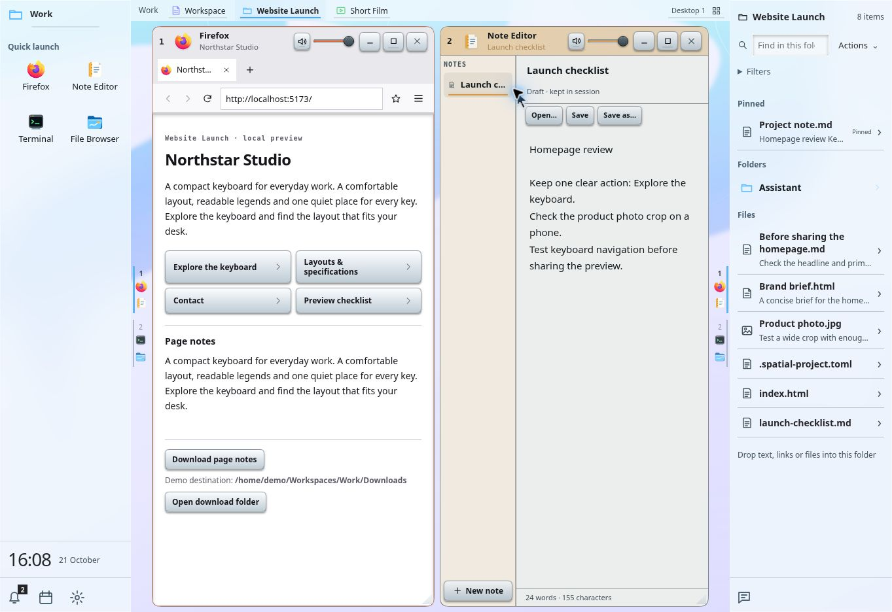

# Spatial Desktop

**A desktop experiment about keeping track of work — and finding your way back to it. Work in progress.**

I started Spatial Desktop after watching [Scott Jenson’s talk](https://media.ccc.de/v/kde2026-7-are_we_really_going_to_use_the_same_desktop_ux_forever). My own frustrations with overlapping windows shaped the design: several apps, documents and browser pages quickly become difficult to follow, especially when another task interrupts me.

This browser prototype explores how windows, ordinary files, projects and activity history can support the same work together. The question is whether those connections make work easier to follow and resume, while keeping the effort of organizing it low.

[Try the desktop](https://xefensor.github.io/spatial-desktop/) · [Desktop Guide](https://xefensor.github.io/spatial-desktop/?guide=start) · [Read the design notes](https://xefensor.github.io/spatial-desktop/philosophy.html)



*The current panel and widget design, shown in the Website Launch demo project.*

## What the experiment connects

- **A visible map of open work.** Automatic tiling keeps windows beside each other. Parking gives a window a visible place when it is set aside, sometimes with useful content or controls. Mouse scrolling moves between vertical desktops; edge markers and the desktop map show where applications are. Individual windows have hotbar numbers, including separate instances of the same app.
- **Projects built around an activity.** A project brings together its folder, resources, windows and column of desktops. It might represent one Jira request or an entire video edit. Materials belong to the activity as a whole and remain ordinary files, available through Files and different apps. Working without a project is supported too.
- **Several ways back to the same work.** Overview brings together Windows, Apps, Projects & Files, Timeline and System. Timeline places recorded activity beside calendar events, tasks and reminders. Session previews show notes, materials and outputs; search finds recorded activity, session notes and available file text, with the matching material and its surrounding session. Recorded origins, versions and source relationships help explain how saved materials connect.
- **Separate work and personal environments.** Each Workspace keeps its own Home and Downloads, windows, app sessions, browser history, media, clipboard, notifications, Timeline and panel layout. Assistant chats and outputs follow their Workspace or Project. Background apps intentionally stay available across Workspaces, alongside shared appearance, hardware controls and master sound. Files and windows can be deliberately transferred; the browser demo models these boundaries without operating-system security isolation.
- **An Assistant in the shared workspace.** Assistant conversations and the default Assistant working folder follow the current Workspace or Project. Readable context and permission to control a display are separate choices. Scripted examples explore working with files and normal windows while the user watches, pauses or takes over. Voice input offers manual dictation, a wake phrase or continuous requests; reading replies aloud is controlled separately and browser support varies.

These ideas explore spatial, associative and episodic memory: finding work by where it is, what it relates to, or when it happened. The [design notes](https://xefensor.github.io/spatial-desktop/philosophy.html) explain the motivation, examples and open questions in more detail.

## Try a whole activity

On your first visit, choose **Explore demo** to open the populated desktop directly, or **Learn the controls** for guided practice. Reopening Guide from an existing desktop offers **Return to desktop**, keeping your saved layout, files and chats, or **Learn the controls**. An active Guide keeps its progress.

Start in **Work → Website Launch**. Explore its preview, checklist and source files, park a window, then switch to another project and return. Open **Overview** with **Super / F2** and try reaching the work through its windows, project files and Timeline.

The populated demo also includes personal planning in General, Urban Ecology in School, a Short Film project and gaming. General starts with only the left panel visible. Panels contain movable widgets and save their arrangement per Workspace; right-click a panel and choose **Edit layout**. The interface uses opaque, rounded ABS app windows and square glass panels.

The [Desktop Guide](https://xefensor.github.io/spatial-desktop/?guide=start) offers practice lessons, including writing a note, browsing and copying text in one Workspace, comparing General’s clipboard, and returning to the original session. The [prototype reference](docs/prototype-reference.md) covers controls, files, Assistant examples, voice, displays and current limitations. [Panels and widgets](docs/panels-and-widgets.md) documents layout behavior.

## Prototype scope

Applications and system behavior are simulated. Files and saved state live in browser storage; separate native browser accounts, cookies and operating-system users are not implemented. Assistant replies follow local scripted rules; it is not connected to an AI model. Calendars and plans are local. The fullscreen game illustrates a Gamescope-style transition; native Gamescope and desktop integration remain future work.

The experiment is intended for trying a workflow: gather materials, make something, get interrupted and return later. Feedback on that experience will help decide what belongs in a native prototype.

## Run locally

The website needs no build step or runtime packages:

```sh
python3 -m http.server 8000 --directory dist
```

Open **http://localhost:8000**. State is saved in browser storage. Use another port or browser profile for an isolated session.

## Develop

Source lives in `dist/`; checks live in `scripts/`. Pushes to `main` run the [GitHub Pages workflow](.github/workflows/pages.yml) and publish `dist/`. Install the development-only DOM test dependency with `npm ci`, then run:

```sh
for file in dist/*.js; do node --check "$file" || exit 1; done
for file in scripts/check-*.cjs; do node "$file" || exit 1; done
```

[Agent instructions](AGENTS.md) · [UI and UX notes](docs/ui-ux-review.md)

Demo captures: [sources](dist/images/design-notes/credits.json). The demo reference photograph retains its [credit](dist/images/philosophy/credits.json).
