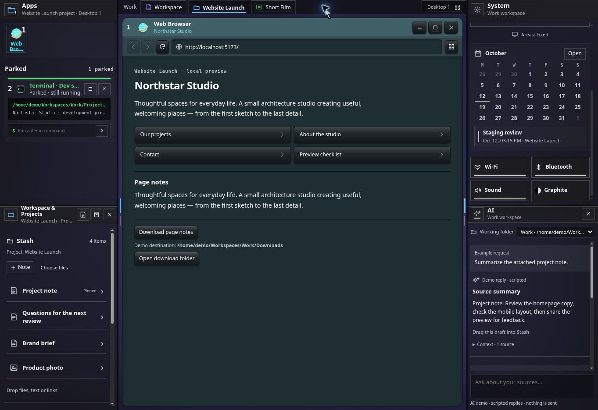

# Spatial Desktop

**A tactile, project-centred computing environment — work in progress.**

Spatial Desktop is a browser prototype exploring a desktop built around Workspaces, Projects and useful docked Areas. It is designed by Xef and developed through ongoing experiments.

[Try the desktop](https://xefensor.github.io/spatial-desktop/) · [Design philosophy by Xef](https://xefensor.github.io/spatial-desktop/philosophy.html) · [Start Desktop Guide](https://xefensor.github.io/spatial-desktop/?guide=start)



*Actual browser capture, 12 October 2026. Work workspace / Website Launch / Desktop 1. All four Areas are visible; Terminal is parked as a useful app card.*

Assistant accepts highlighted app text and selected files through **Ask Assistant** or **F2+A**, with reviewed browser-local text/image conversions into a chosen folder and retained input/output history.

## The idea

- Windows tile automatically and share numbered shortcuts with the Apps hotbar. Each title bar shows its number; new windows open left to right, then top to bottom, with four preferring a 2×2 grid when they fit.
- Park apps as useful cards instead of hiding their work. Float a window when placement matters.
- Projects keep their own folders, windows and vertical desktops, and resume automatically. Workspaces separate broader contexts such as personal life, study and work.
- Apps, Files, System and Assistant remain in left or right docked Areas, stacked vertically, that can be Expanded, Compact or Hidden. Drag the separator between Areas to give one more room than its neighbour. Expanded Areas stop at a readable minimum; push past that stop to snap into a fixed Compact size, or pull away to restore Expanded. The same gesture works at the dock’s resize border. Narrowing the whole dock makes every Area Compact and fills the screen edge; short Compact cards stay fixed only inside wide docks. Inside a whole Compact dock, dividers share space continuously between control minima, without snapping or expanding the panel. Layout proportions and remembered Expanded sizes save per Workspace.
- Compact Areas arrange icons across their available width and keep working material and live controls within reach: an interactive folder shelf, focused System controls and a quick Assistant chat open temporarily without resizing the dock.
- Areas, Overview and temporary popups share quiet translucent glass sheets. Navigation, icon actions and rows sit directly on the sheet with clear hover, press and keyboard-focus feedback; toggles retain a selection indicator. Fields and primary actions remain distinct, while app-window ABS controls keep their tactile 3D caps.
- Files combines the project folder or Workspace Home with editable notes, links, inline media previews and pinned materials. Browse subfolders, create notes or folders, add files and send a selected file directly to Assistant. Existing Stash material migrates into the same folder with its identity and history retained. References share an item; independent copies keep their own contents and a source link. Assistant replies retain their attached evidence, and Timeline can group activity into expandable sessions. Overview keeps horizontally scrollable tabs: **Windows**, **Apps**, **Projects & Files**, **Timeline** and **System**, with search above every tab.
- System follows the same near-to-wide order as Apps: current-desktop requests, current-project plans, Workspace notifications/focus/calendar, then shared alerts, other Workspaces, clock, devices and machine controls. Compact keeps that order too.
- Overview's **System** tab mirrors the System Area's scope order. It holds local notifications, shared system alerts and other Workspaces' unread badges. New foreign arrivals only light their icon and update the count; click to preview without switching context. Steam remains separately grouped on the right. Background apps share the bottom Apps row across Workspaces.
- **Settings** is a normal app window: tile it beside your work, maximize it or park it. Its sidebar groups **Your work**, **System** and **About**; search finds individual settings and opens their page. Each page names its scope, so Workspace Area layouts stay separate while appearance and shared machine controls apply everywhere. Settings is included in Workspace favorites for Apps Quick launch and Overview → Apps, and is listed under the System category. The System gear and search open the same app.
- Additional displays have roles set in **Settings → Displays** or **right-click desktop → Display role**: **Extended workspace** follows your desktop and Project. **Side space** keeps reference windows in place, with Workspace folder shortcuts, pinned files/folders/web links, an autosaved scratch note and a checklist. **Assistant** puts the existing chat beside a canvas for real demo files and notes: attach a selection, review a scripted reply, save it to Files or run a supported local conversion. It shares chats, drafts and saved inputs with the Assistant Area. Both supporting modes keep their tools at the left screen edge without a top header, and retain separate content for each Workspace. One display remains **Main workspace**. The demo links a second browser window; it does not configure native monitors or run an autonomous agent.
- Fallout demonstrates a Gamescope window: its fixed 2560 × 1440 game display scales into a normal tile or fills the screen. Meta+F (F2+F in the browser) switches both ways; Win+D / F2+D tiles it. Overview → Windows offers both presentations. This is simulated in the browser; it does not run Gamescope or control hardware VRR. Steam and Fallout are available in every Workspace; Steam contributes local chats, guides and notes with separate data per Workspace.

Firefox and Steam show read-only window previews when parked; apps with a parking widget keep their interactive controls.
App-owned dialogs park directly below their app preview as a connected group. Try Firefox's **Save page as…** from its menu or **Ctrl+S**, then park Firefox; restoring either card brings back both the window and its waiting dialog.
**Save in** groups that window's default location, Project folders and Workspace Home folders. The choice applies to one file. Desktop context menus follow the same near-to-wide order, with named Project actions, Workspace Home/Settings and shared system Settings.
Use **Hide preview** in a window or parked card's context menu to show only its app identity and a restore placeholder. Attached dialog content is hidden too, while **Needs input** stays visible. The choice saves per window; **Show preview** restores its preview or parking widget.
Left-click **Close** closes the window while needed activity can continue; middle-click **Close** force quits that app instance and stops its activity. Background-only apps are shared services with no desktop or Workspace owner. Their icons appear at the bottom of Apps everywhere; click for global controls or choose **Open window here** to restore their running state on the current desktop. Try playing Music Player or starting Steam's local demo update, then close its window.

Desktop Guide introduces these interactions through 32 steps across 14 chapters, including independent app windows, quick launch from an empty desktop and switching a Gamescope window between fullscreen and tiled presentation on its original desktop. The [design philosophy](https://xefensor.github.io/spatial-desktop/philosophy.html) is Xef’s own unfinished text, being written one topic at a time.

## Run locally

No build step or npm dependencies:

```sh
python3 -m http.server 8000 --directory dist
```

Open **http://localhost:8000**. State is saved in browser storage. Use another port or browser profile for an isolated session.

## Develop

Source lives in `dist/`; checks live in `scripts/`. Pushes to `main` run the [GitHub Pages workflow](.github/workflows/pages.yml) and publish `dist/`.

[Agent instructions](AGENTS.md) record Xef's default workflow: verify requested project changes, commit and push them to GitHub unless he explicitly asks for a preview without publishing.

```sh
for file in dist/*.js; do node --check "$file" || exit 1; done
for file in scripts/check-*.cjs; do node "$file" || exit 1; done
```

[Controls and prototype reference](docs/prototype-reference.md) · [UI notes](docs/ui-ux-review.md) · [Source history](docs/history/README.md)

This is an interaction prototype with simulated apps, folders and system actions. Assistant replies are scripted; calendars and plans are local. Native OS integration remains future work. Reference media retain their individual [credits and licences](dist/images/philosophy/credits.json).
