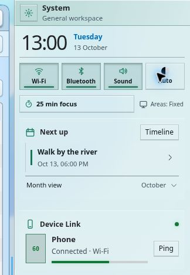
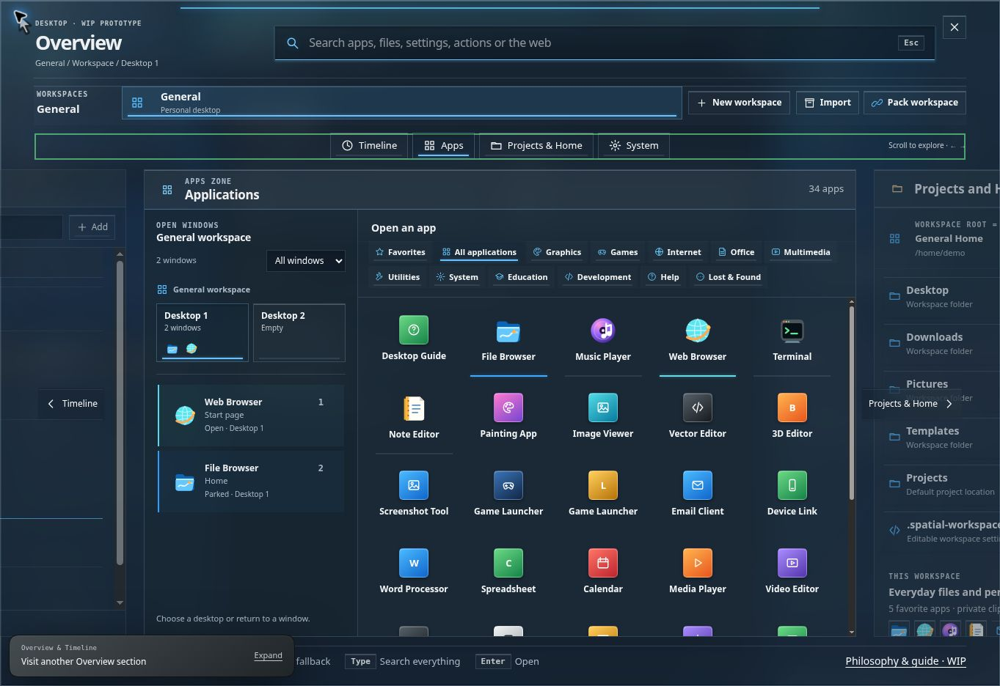
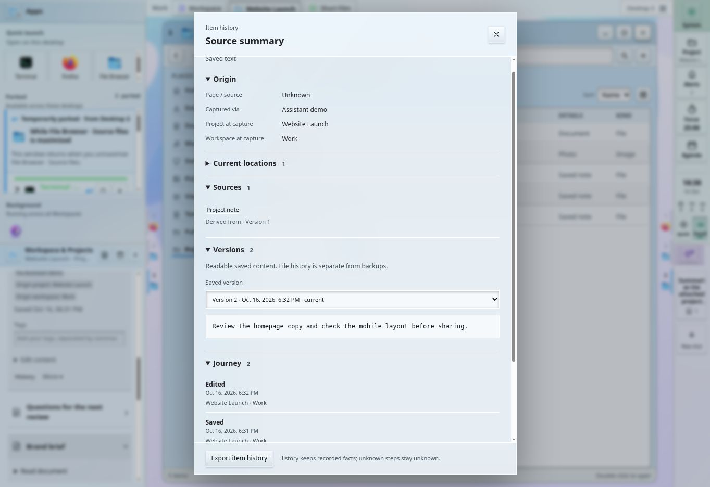

# Prototype reference

Current implementation reference; Files, Assistant, Timeline and display-role sections were updated on 17 October 2026. The main design philosophy is Xef’s unfinished author text; this document separately describes implemented prototype behaviour. Start with the [README](../README.md) or the [live design philosophy](https://xefensor.github.io/spatial-desktop/philosophy.html).

## Context and ownership

| Context | Role | What it retains in the prototype |
| --- | --- | --- |
| Workspace | A broad context such as General, School, Work or Gaming | Home folders, Area configuration, app sessions, browsing history, player state, local activity/plans and workspace Stash |
| Project | A piece of work rooted in its own folder | Its windows, vertical desktops, files/resources and project Stash; several Projects can stay open |
| Desktop | Another page inside a Workspace or Project | Window placement on that page; vertical scrolling changes the page |

The ordinary Workspace and each open Project appear in the horizontal context strip. Switching Project moves the scene horizontally; changing its desktop moves the window canvas vertically while Areas remain in place. Desktop indicators on both sides offer **Lines only** or **Lines and app icons**, selected by right-clicking either indicator strip or in **Settings → Appearance → Desktop indicators**. The menu marks the current choice and names its System-wide scope; the left strip also supports Context Menu or Shift+F10. Lines only hides the numbers and icons and restores the original filled desktop-position bars: muted 2 × 22-pixel bars with a 6-pixel gap, and a 3 × 34-pixel accent bar for the current desktop; Lines and app icons is the default and shows every page number and every open window icon in the selected Workspace or Project column, including separate instances of the same application. The preference persists across reload, applies to all Workspaces and synchronizes between displays. Lines only fits the existing 8-pixel tile inset without reserving additional canvas space; the icon mode reserves 24 pixels on each side. Tiled windows immediately refit to the available canvas; floating windows keep their screen position. A thicker, fully colored accent line and a stronger number mark the current desktop. The position lines stay aligned at the same distance from Areas in both indicator modes. The compact icon groups keep their own space beside windows, showing the original wallpaper without a panel background, blur or full-height column. Adjacent Areas use inset highlights rather than external blurred shadows, and the closed Overview has no active backdrop filter. Parked apps belong to the whole Project or ordinary Workspace column and remain available in Apps; they do not appear in desktop strips or create page markers from their remembered placement. Closed windows and system-wide background services are also excluded. The icon layout keeps full-size 18-pixel app icons inside a compact 25-pixel input strip, starting 1 pixel from each Area edge, with 2-pixel muted lines and a 3-pixel accent line for the current desktop. Centered 21-pixel inactive and 22-pixel current groups align their strokes exactly with the filled bars in Lines only. Icons never overlap window content; Lines only uses the original 6-pixel-wide strip. Both strips remain interactive for the context menu and have no panel background. The groups scroll if their complete icon lists exceed the available height; there is no icon cap or +N summary. The current empty page remains visible. Fullscreen hides the strips with the Areas. The design uses bounded desktop pages rather than canvas zoom or permanently exposed portions of neighbouring desktops.

Project navigation and window arrangements save automatically. Closing a Project saves its session; opening it again resumes that session. There is no manual save-place or Continue working step. Named project Modes belong to earlier versions; current interaction uses desktop pages.

Window options can move a window between desktops, Projects, Workspaces and demo displays, or detach it into the ordinary Workspace so that closing the Project no longer closes that window. Separate app instances keep their own state.

**Move to…** now uses nested destination menus rather than a flat list. **This Project / This Workspace** lists its desktops, **Other Projects** opens Project → desktop (including Workspace desktops outside Projects), and the separated **Other Workspaces** branch opens Workspace → desktop. Each desktop names the complete destination path; the current location is disabled and marked **Current**, and the trailing empty desktop is marked **New**. Closed Projects say that the window is stored until the Project is opened. Moving to another Workspace targets its ordinary Workspace context, with its Home shown explicitly; window content is retained and open file locations stay at their original paths. This is simulated window/session transfer, not native process or Home migration. Display transfer appears under **Displays** when a second display is available.

Hover or click opens a submenu. Up/Down and Home/End stay in its current level; Right opens a child, Left or Escape returns one level, and each popup has a Back control for pointer/touch use. Tab closes the menu. Submenus flip at screen edges and scroll independently. Selecting a destination keeps the current view and offers placement Undo; newer edits to a transferred destination window prevent stale Undo. These menus also work on windows reached through Overview and on parked windows through **Window options…**.

The desktop context menu starts with **This desktop**, naming its number and context. Broader commands follow in **Project → Workspace → System-wide** submenus. Project offers its actual folder, Manage and **Close Project: <name>**, which saves windows across all of that Project's desktops. Workspace offers its Home and the Workspace page of Settings; System-wide opens the shared Settings app or the philosophy/Guide. Empty scopes are omitted, and Guide progress gates the available commands. Window menus identify their owning desktop/Project/Workspace; Close and Force quit name the selected app, and a new-window command names where its new instance will open. Background app menus are explicitly System-wide and offer shared controls, Open window here and Force quit. Area menus explicitly apply to every desktop and Project in the named Workspace.

Workspace separation is simulated under one browser profile. It does not create native users, sandbox applications, change native Home folders, enforce file permissions or replace the system clipboard.

## Desktop Guide and setup

The visible app is **Desktop Guide**. `Spatial Guide` remains a legacy launch key in source. New visitors begin on an empty desktop and can take the hands-on introduction or choose their desktop. Existing sessions do not have to repeat it.

The current fourteen chapters contain 32 steps, including the welcome and finish screens:

| Order | Chapter | Purpose |
| --- | --- | --- |
| 1 | System | Try a quick setting and learn toggle feedback |
| 2 | Apps & Overview | Open a tool, find another through search and create an independent copy |
| 3 | Windows | Tile, float, Maximize and try Fullscreen |
| 4 | Parking | Put a useful app aside and bring its window back |
| 5 | Desktops | Change page and launch an app directly from an empty desktop |
| 6 | Stash | Save and inspect an idea without requiring a Project |
| 7 | Assistant | Attach a source, write a request and keep a scripted reply |
| 8 | Projects | Create a Project and use its separate windows/desktops |
| 9 | Workspaces | Create a Workspace and explore its Home folders |
| 10 | Overview & Timeline | Find work and compare local activity with a plan |
| 11 | Arrange your Areas | Resize, dock, hide and recover Areas |
| 12 | Try it on your own | Combine actions without target highlights |
| 13 | Gamescope | Tile the fixed game display, then show its outer window fullscreen on the same desktop |
| 14 | Two displays | Optional second-window practice, followed by a walkthrough of display roles |

Tasks use generic app names and let learners choose compatible tools. Each task can be skipped; the next task prepares missing prerequisites. Examples and extra explanations are expandable. Only introduced Overview sections are exposed during practice. The Guide supports expanded/compact presentation and contextual recovery when a window is closed, parked or in the wrong context.

The Gamescope chapter prepares the real Fallout 4 example in Gaming, using isolated practice storage. The game fills Desktop 1 without an outer frame or Park, Maximize and Close controls. Learners use **Meta + F / F2 + F** or **Overview → Windows → Show tiled**, then focus the tiled game and use the same shortcut or **Show fullscreen** on its Gamescope card. The virtual screen keeps its 2560 × 1440 resolution and 16:9 aspect ratio in either presentation. Both modes stay on the original ordinary desktop, with no temporary desktop, bottom preview or extra second-display navigation step. Ordinary whole-display windows such as Firefox are separate from this borderless-screen shortcut. An in-progress old Firefox practice changes to Fallout without resetting other Guide chapters, and existing lesson/goal IDs preserve saved progress. The game's **Open Overview** button opens Windows during practice; the Steam-contributed section stays excluded.

The Guide audit also updated expanded explanations for hotbar numbering per window and its first twenty shortcuts, row-based tiling, carrying a window with title-bar + scroll (Shift for Project columns), Undo after hiding or docking Areas, Gamescope cards and Steam's contributed Overview controls. Existing saved lesson IDs and version-eight positional progress migrate without losing completed goals.

Repeated introductions and chapter practice use isolated storage. Progress survives reload. Leaving a repeated introduction offers a return to the original session; individual chapter practice returns directly. Explicit **Clean desktop** or **Explore the demo** choices replace the current session while preserving display preferences. A clean desktop has General only, with no open apps or Projects. The temporary second practice display closes when its chapter ends and does not join the original session.

Find Desktop Guide in **Overview → Apps → Help**, or search its name. [Start the guide](https://xefensor.github.io/spatial-desktop/?guide=start).

## Demonstration scenes

| Workspace | Example activity | Initial context |
| --- | --- | --- |
| General | Everyday files | Ordinary Workspace desktops; no open Project |
| School | Urban Ecology research | Reading, observations and survey evidence in a Project |
| Work | Website Launch and Short Film | Two Projects, each with two desktops |
| Gaming | Co-op session | Desktop 1, with Firefox and the Fallout virtual screen in the same desktop, Steam and Music Player parked |

General opens with **Apps expanded on the left** and **System Compact on the right**. **Workspace & Projects** and **Assistant** start hidden and can be shown through Overview. The one-time layout update adopts this arrangement for the former shipped General layout while preserving customized Area layouts and other Workspaces.

Website Launch pairs a preview with its development terminal on Desktop 1, and source files with a checklist on Desktop 2. Short Film pairs footage with edit notes, then cut feedback with a parked soundtrack player. Urban Ecology pairs reading and observations, with survey evidence on the next desktop. The data and app content illustrate workflows.

Setup pairs use side-by-side vertical halves. Automatic openings fill a row from left to right, then start the next row. Three windows prefer two across the top and one full-width below; four prefer a 2×2 grid even on a wide display. If that would violate app minimum sizes, the automatic layout falls back to a width-based arrangement. Minimum usable sizes and floating obstacles can constrain placement. The one-time order migration changes exact old shipped split trees; manually rearranged trees remain intact. Broader scene migrations preserve edited Project definitions and notes, and skip Workspaces attached to custom Projects.

## Window placement and parking

Tiling shares the bounded space between Areas. Left-drag a title bar to rearrange tiles; drag a divider or resize handle to change their shares. The new-window order does not depend on which window was last focused. Manual edge drops select a specific split. Middle-button title-bar dragging or Alt+left-drag floats a window; a normal drag or the window menu returns it to tiling.

Tiled windows avoid floating obstacles when space allows. Floating windows can overlap one another. Space pressure and fully obscured/offscreen windows can park in Apps rather than become unreachable. Window fitting does not promise every app remains visible at every viewport size.

Each window title bar has a **volume slider** and a speaker button to **mute/unmute that window**. A narrow tile keeps the slider and speaker, hiding the numeric percentage. Arrow keys adjust the focused slider; Home and End select 0% and 100%. Moving the slider unmutes; the speaker restores the previous audible level from 0%. Separate instances of the same app have independent levels. Volume and mute follow the window when moved or parked, survive reloads, and remain separate between Workspaces. Music Player's header and its existing in-app volume/mute controls share the same setting. Embedded audio/video previews inside that window use its level; their native volume controls also update the header. Changing a level preserves playback position and does not start playback. System Sound remains a separate shared demo control. Music Player playback is simulated; the web prototype cannot control native applications, external iframe audio or operating-system audio streams. A native desktop would need audio-stream routing to implement that part.

**Park** replaces minimization in the visible interface. The window leaves the canvas but its app remains available through a useful card. **Unpark** restores it on the currently viewed desktop in its owning context. Parked apps travel between desktops inside that Workspace or Project; parking does not change ownership.

Apps with a parking-widget integration keep their useful controls in the card, such as Music Player transport or an editable note. **Firefox and Steam** deliberately have no parking widget: their card shows a read-only **Window preview** of that specific app window, including its current tabs, page and visible app content. Clicking the preview or **Unpark** restores the original window; dragging the header places it on the desktop. The preview cannot type, click links, switch tabs or activate app controls. Header dragging survives a tray refresh; Escape, pointer cancellation, focus loss and hiding the page cancel it without restoring the window or leaving a drag ghost. Browser instances keep separate previews and hotbar slots. Preview-only apps expose ordinary window actions in Compact, without invented background commands.

The web prototype renders an inert copy of its own simulated app DOM, with isolated styles and icon definitions. Content changes update the preview without a polling timer; Area resizing preserves the full window's proportions. Copies omit window identities, action attributes and duplicate document IDs, and keep live input values. A native implementation would obtain the application's surface from the compositor. This demo does not capture real third-party windows.

The Area header simply says **Apps**, with context retained in its Overview button tooltip and accessible label. Section helpers explain what belongs where: **Quick launch — Open on this desktop**, **Parked — Available across these desktops**, and **Background — Running across all Workspaces**. “These desktops” means the selected Project’s desktops, or the ordinary Workspace desktops when outside Projects. No new Desktop group or Column label is required. Compact groups hide the helper text while keeping the same scope in accessible labels and tooltips. Apps starts with **Quick launch** in both Expanded and Compact presentations. Its icons come from the current Workspace’s runnable favorites, falling back to its usual demo apps when needed. They launch apps into the current desktop and Project without window numbers or running-state indicators. A regular app that is already open or parked gets a new independent window here. Existing parked windows retain their content and ownership; restoring them is an explicit action through their card, compact icon, Windows entry or window search result. Application launchers and application search results use this same new-window policy. Shift+click requests a new window, while single-instance apps such as Steam and Fallout return to their existing window. Parked cards retain the app’s own subtitle (such as the note title, current folder or page) instead of replacing it with a generic running-state label. Expanded Apps keeps useful parked cards below Quick launch; Compact shows parked icons below it. Open windows keep their numbers on the desktop and in Overview. Right-click a parked icon for relevant background actions. Commands such as playback keep the window parked; opening a file or note restores it. **Window options…** opens the movement menu.

Windows temporarily parked by Maximize appear above ordinary **Parked** cards, grouped under the owning app’s icon and **While <owner> is maximized**. The shared **Parked** heading and scope stay visible above all return groups; **Other parked windows** separates ordinary cards when both kinds are present. The group explains: **These windows return when you unmaximize <owner>.** Each group has its own glass enclosure, a leading edge and header tinted with the owning app’s color, plus an origin heading such as **Temporarily parked · from Desktop 2**, including Display when there is more than one monitor. Extra spacing separates return groups, and a stronger neutral divider marks ordinary Parked. Private owners use a neutral accent. Its cards carry a return-arrow badge; compact parked icons show the same arrow, with the owner and original desktop in their tooltip. Groups follow the actual automatic-return relationship within the current Project or ordinary Workspace, including other desktops and displays. A hidden owner preview uses generic owner text. Manually parked windows keep their ordinary presentation; the return indicator appears only while an automatic return is still pending. These labels explain the existing restore behavior.

### Numbers and shortcuts

Window shortcuts follow visible windows’ reading order: left to right across a row, then top to bottom. Moves and retiling update both numbers and shortcuts. Parked entries follow the open windows in that sequence. Every separate app instance gets its own slot. Each open app title bar shows the matching number as plain text with no border, background or shadow; parked cards and compact icons keep their matching numbers. Quick launch icons have no shortcut number.

| Slots | Shortcut |
| --- | --- |
| 1–10 | Super+1–9,0 |
| 11–20 | Super+Shift+1–9,0 |
| Later slots | Click the window in Overview or its parked card/icon; no additional keyboard bank is bound |

**F2 is the browser-only alternative to Super.** Press and release F2 alone to toggle Overview; hold F2 with 1–9 or 0 for the hotbar, add Shift for slots 11–20, use F2+A for Assistant, F2+F to toggle the focused Gamescope window between fullscreen and tiling, F2+D to tile a currently fullscreen Gamescope window, F2+scroll for desktops and F2+Shift+scroll for Project columns. Press F2 before the other keys. Release after a combination does not toggle Overview. Leaving the browser clears the held key. This does not remap the host OS. Alt+number and Alt+Shift+number remain browser fallbacks. Focus or restore with the shortcut; invoking it again on the focused window parks that window. Shift+click a Quick launch or Overview app icon creates another app instance. The host OS may intercept Super shortcuts.

### Preview privacy

An open window, compact parked icon or parked card's context menu offers **Hide preview** / **Show preview**. The preference belongs to that particular window in its Workspace session, persists through restore/repark, close/reopen and reload, travels with a transferred window and synchronizes between displays. Sibling windows have independent settings.

A hidden parked card contains only the app identity, **Preview hidden** and its normal restore/close controls. Its placeholder restores the original window and its header still supports drag placement. This also replaces interactive parking widgets such as Notes or Music Player, so their text and app controls are not exposed in a private card. An attached dialog stays below its app, connected and labelled **Needs input**, but its title, filename and destination are omitted. Restoring either card focuses the real dialog as before. The window's own visible contents are unchanged when opened.

Hidden windows bypass snapshot/widget rendering; existing cached DOM snapshots are discarded rather than blurred. Overview's window detail and tooltip say **Preview hidden** instead of the document title. A hidden borderless app also uses a plain icon scene in its Gamescope Overview card. This controls window previews; it does not erase the window's saved content or separately saved Stash/Timeline entries.

### Background applications and closing

Apps has three positions: Workspace-specific **Quick launch** icons at the top, parked cards or compact icons in the middle, and small **background-only** icons at the bottom. The bottom section labels its scope as **Running across all Workspaces** in expanded Apps and in service tooltips. The bottom row exists only when needed, stays outside the parked list's scroll viewport and keeps its position in Compact Apps. A horizontal Compact Area places it at the trailing end. Background services have no hotbar number, desktop, Project or Workspace owner. The same shared services appear across all Workspaces and desktops, without origin badges or Workspace names. Their state lives in a separate shared service registry; legacy per-Workspace background flags migrate once without replaying stopped services. Explicit removal records and service revisions preserve stops/restores during display synchronization.

Left-clicking a window or parked card's **Close** closes that window. Needed playback, Steam downloads or game services detach into the shared background registry, preserving their current state. Idle apps exit. Middle-clicking Close **force quits that window instance**. Clicking a background icon opens **System-wide background app** controls in place: music transport or Steam download Pause/Resume. It never switches Workspace or Project. **Open window here** consumes the background service and restores its state into a fresh window on the current desktop, preserving other existing windows. Launching that app while its local base window is closed also returns an available background service here. Middle-clicking the background icon, Force quit in its menu or its controls stops only that service. An explicit paused service remains available to resume; completed downloads and ended game-only services disappear without navigating.

Steam's **Download demo update** is a local simulation. Both window and background downloads advance, preserve progress across reload/display synchronization, and catch up without duplicating elapsed time. A completed shared background download produces a quiet **system-wide** alert. Music in a detached background service continues advancing independently of Workspace switches; its global controls can pause it or move tracks. Hidden previews keep track content generic until the user opens its full window. Open and parked window sessions retain their ordinary Workspace ownership. These are browser-local service models; the demo does not inspect native processes or change native Home folders.

### Dialogs attached to an app

Firefox's menu offers **Save page as…**; **Ctrl+S** opens the same local demo dialog. It belongs to the particular Firefox window, blocks that window's content while leaving its title bar available, and follows its desktop, Project and display. Other apps remain usable. Park Firefox while the dialog is open: its read-only app preview stays above an indented dialog card, connected by the app's accent line and labelled **Dialog · Firefox** and **Needs input**. Both belong to one parked group and one app slot. The dialog does not become an independent parked app. Clicking either preview or Unpark restores the same window and focuses the waiting dialog; dragging the parent card also restores the group. Switching contexts and reloading preserve the dialog and its filename. There is no automatic focus switch while parked.

**Save in** groups destinations from near to wide: **This window** keeps its default save/download location; **Project** offers the owning Project's folder and Downloads; **Workspace** offers its Downloads, Documents, Desktop and Home. The full path stays visible. Empty scopes are omitted; other Workspaces and unsupported system storage are not suggested. This one-file choice leaves the download preference unchanged, persists with that particular dialog across parking and reload, and falls back to the new owner's default if the pending window is transferred to a different Project or Workspace. **Save** writes the captured demo page text into the selected simulated folder, retaining its destination ownership. Existing files and listed example names receive a numeric suffix instead of being replaced. **Cancel** or Escape dismisses the dialog; explicitly closing the parent also closes its dialog. A second Firefox window has its own dialog state. This is a prototype of app ownership and scoped save destinations, not an integration with native file pickers or external app dialogs.

### Maximize and Fullscreen

| Action | Input | Space and other windows |
| --- | --- | --- |
| Maximize | Left-click maximize, or double-click title bar | Fills the canvas between Areas; peers move to the second display when they fit, otherwise park |
| Fullscreen | Middle-click maximize | Fills the whole display; peers transfer or park, and Areas transfer when possible or temporarily hide |
| Restore | Repeat the control; Escape also leaves Fullscreen | Returns automatically parked/transferred peers and temporarily moved/hidden Areas |

Explicit moves, closing or parking cancel automatic peer return. A busy second display is not cleared to make room: candidate transfers must fit without parking its existing apps. Both displays are browser windows on the same origin/profile, with prototype display assignments rather than native monitor management.

## Navigation and Areas

An empty desktop shows **Start here**, its Workspace or Project and desktop number, and quick-launch icons for the demo's working apps. A local **Search apps, folders and files** field filters names and paths in place, using the same accent-insensitive, multiword matching as Overview. Enter opens the first match; Escape or Clear resets the query. The field and its caret survive ordinary refreshes, while switching desktop, Project or Workspace starts a fresh query. **Folders** begins with the current Project folder when selected, then this Workspace’s Home and common folders. **Files** includes the selected Project’s file listing, correctly scoped saved downloads and saved Stash files; foreign Workspaces and other Projects are excluded. **Show all** expands each list locally. Clicking a folder creates a fresh File Browser on this desktop. Clicking a file also opens its normal preview, including actual saved download or Stash content; existing open or parked browsers keep their location and contents. Listed-only example files retain their explicit demo placeholder. **All applications** remains an optional route to the Apps section in Overview. Launching a regular app that is already open or parked creates an independent window on the current desktop and display, preserving the original window and leaving parked work parked. Shift+click explicitly requests a new window. Single-instance apps such as Steam and Fallout show **Return to app** when already running. Steam and Fallout are available from every Workspace’s launcher and search. The launcher disappears while this display has an open window and is excluded from fullscreen surfaces. In the guided introduction it appears from the empty-desktop lesson onwards.

Scroll over an Area header, Compact controls or non-scrollable content to change vertical desktop pages, even while a window is focused. Scrollable Area content keeps its wheel at both edges; input fields retain their normal scrolling. Nested scrollers do not pass motion to outer panes. Shift+scroll over an Area switches between the ordinary Workspace and open Projects unless a nested horizontal scroller owns that motion. You can also click desktop background or an Area to release window focus, then scroll over the canvas. Super+scroll and Super+Shift+scroll work from windows or Areas when the browser receives them. Page Up/Down provide desktop navigation with focus released; Shift selects Project navigation.

While holding a title bar with the left mouse button, scroll to carry the window to another desktop; Shift+scroll changes its Project context. Release to place it. Cancelled drags return to the original placement. Ordinary scrolling inside focused apps remains an app action.

All four Areas default to vertical side docks: Apps and Workspace & Projects on the left, System and Assistant on the right. Move an Area using its header/handle; resize the shared column or row from its inner border. Drag the separator between neighbouring visible Areas to change how much of that column or row each one receives. **Expanded** and **Compact** are presentations of the same Area. Compact retains useful context and quick actions: Apps keeps Quick launch and parked windows, Workspace & Projects keeps working materials, System keeps live status and controls, and Assistant keeps the current conversation and its sources. Any Compact Area sharing a wide side column arranges its existing shortcuts and controls into wrapped icon rows across that width; short panels keep their content scrollable. The Desktop Guide app’s compact view is a separate control for its own window.

Every Area header's context menu offers **Expanded**, **Compact** and **Hidden**, with the current state marked. Each Area keeps its own preferred presentation, so Compact and Expanded Areas can share one dock column. They share the column’s width, while Compact content fits that available width; choosing Compact for one Area does not force its neighbours to change presentation. Areas dock only on the left or right side, stacked vertically in each panel. Their context menu offers Move to the opposite side. Dragging near the top or bottom still chooses the nearest side; it never creates a horizontal Area row. Expanded Areas stop at a readable minimum instead of shrinking into cramped intermediate sizes. Continuing the drag 48 px beyond that stop deliberately snaps the Area into its fixed Compact preset. An embedded Compact card in a wide dock cannot be freely resized smaller or larger: pulling 48 px away from its stop restores a useful Expanded size, using the remembered Expanded size when it fits. These resistant stops apply to all four Areas at separators and at the dock’s resize border, on either side of the screen. Choosing Compact from a menu uses the same fixed preset. Only an insufficient physical viewport can force the layout below its normal minimum; it stays fitted to the display rather than overflowing. Without custom proportions, the allocator retains the largest feasible number of useful Expanded Areas instead of compacting every Area whose equal share would be short. When all contents resolve to Compact, the dock also resolves to its narrow width. Stored width and presentation preferences survive automatic content pressure and recover when space returns. Hidden applies to the chosen Area. Docking into an occupied edge joins that column rather than replacing its width or its neighbours’ presentation. Expanded remembers the previous expanded size. The same menu is available with Shift+F10 from a focused header control. Dragging remains available; Escape, a cancelled pointer or leaving the browser cancels an unfinished Area gesture.

Completed Area changes and window moves offer **Undo** in their feedback message. A resize grip click or blocked drag that leaves the layout unchanged preserves the original manual flags, remembered sizes and shares, and creates no Undo offer. Recovery restores placement and state, not document text, chat drafts or playback contents. The offer applies to the just-completed change; if another layout, context or display change intervenes, the previous offer cannot overwrite it. Maximize and Fullscreen keep their existing automatic Restore behavior.

Saved top-docked Areas move to the left panel and bottom-docked Areas to the right, after that side’s existing Areas. Relative order, visibility and Compact/Expanded preferences survive, including on portrait displays. Existing side widths and vertical shares remain; retired horizontal proportions do not become height ratios. Wide Compact cards, such as System below Expanded Apps, remain available.

A column of Compact Areas uses a fixed narrow thickness and stays anchored to its screen edge. Its Areas fill the dock’s entire length according to the saved proportions, or share it evenly without custom proportions. Collapsing an Expanded Apps column with an embedded Compact System turns both into normal narrow rails; it does not leave two short cards at the top with unused space below. Expanded Apps can share a side column with Compact System: System snaps to a fixed short icon panel and Apps receives the remaining height. Short fixed Compact card presets apply inside a wide dock; they depend on the Area and dock orientation. Narrow rails instead keep useful control minima while filling their lane. Their separators resize the adjacent pair continuously, with hard minimum lengths and no snapping, pressure band or presentation change. Even a long drag at the minimum cannot expand an Area or widen the panel. Use the outside dock border to expand it. An Area alone fills its lane along the screen edge; dividing that length requires a neighbouring Area. On physically short displays, panels fit the available extent and their tools remain scrollable.

Pulling the outside border of an all-Compact dock restores the grabbed Area's Expanded contents as well as the dock thickness, reclaiming its usable length from saved sibling proportions. If the display cannot fit that Area beside its Compact neighbours, the dock stays Compact and its narrow rails fill the available lane. Repeated outer collapse/restore gestures preserve the same usable layout rather than leaving Compact contents in a wide column.

Separators work for all four Areas: drag up/down between neighbours in the left or right panel. Resizing Expanded Areas adjusts the neighbouring pair. In a wide dock, pulling an embedded Compact card open can reclaim room from its peers. The divider inside a whole narrow Compact dock only changes the adjacent lengths; it never changes the dock thickness. The outside handle sets the whole column’s width. The separator can also receive keyboard focus: use Up/Down in the vertical stack, in 16-pixel steps while Expanded. Normal arrow presses stop at the readable minimum. In a wide dock, use Shift with the resizing arrow at a stop to deliberately snap into Compact, or Shift with the opposite arrow to pull back into Expanded. In a whole Compact dock, regular arrows share 16 px and Shift + arrows share 48 px, both clamped at Compact control minima with no snap. A completed adjustment offers one Undo, and Escape cancels an unfinished drag. Proportions, presentation and remembered Expanded sizes save per Workspace and dock edge, including across reload. **Reset Area size** clears that edge’s custom proportions; **Reset Areas** clears them everywhere in the current Workspace.

Right-click System and choose **Compact below Apps** to arrange both Areas in one action, with one Undo for the complete change. Dragging System onto the lower half of Apps offers the same ordered placement while preserving its presentation. The preview uses the committed layout constraints, including hidden peers and the opposite dock’s canvas budget. Making System Compact resets its scroll position so the clock and alerts are immediately visible. Embedded Compact System uses a quiet local tool grid above a separated machine footer: the clock/date and other-Workspace badges share one row, with equally sized Quick and Sound controls below. These groups retain their structure as the dock width changes; additional requests, project controls or shared alerts remain reachable in the Area’s scrolling viewport. Embedded Assistant keeps its draft indicator beside its chat title rather than over it. Temporary shelves, quick chat and focused System flyouts open over the scene without changing the column’s saved size or moving tiled windows. Close the temporary view to return to the same Compact Area. Choose Expanded explicitly, or pull the outside dock border past the Compact stop, to restore full content at a useful size. Existing saved layout keys remain compatible.

All four Areas share bounded content viewports and visible keyboard focus. Expanded Apps allows two-line launcher and parked-window names while keeping their controls separate. Workspace & Projects keeps Stash search usable at narrow widths, wraps long file names, and marks Compact pinned materials with a tinted accent edge. In Compact System, local tools scroll separately above its fixed machine footer when optional controls need another row. Assistant wraps its toolbar and rename controls when needed, bounds opened input details, and keeps the composer available. These refinements retain the existing scope, saved layouts and temporary popovers.

All four Areas can be hidden through their context menus and restored in **Overview → System → Desktop Areas**. Super or the Overview keyboard fallback remains useful if every Area is hidden. Visibility and dock layout save per Workspace. Ordinary tiling respects dock bounds; explicit floating/fullscreen interactions can request temporary Area changes. Fullscreen Area transfers/hiding are reversible and respect Manual mode.

Border drags stop at available space rather than pushing the opposite Area offscreen. Side docks have a 520 px ceiling, also capped at 40% of the display width. Up to 440 px width remains reserved for the canvas, scaled down on small viewports. Old oversized states are fitted to the current display; the preferred size can return on a larger display.

## System Area

System follows **desktop → project → Workspace → system-wide**, in both Expanded and Compact layouts. **This desktop** identifies the current desktop and surfaces app-owned requests only for visible windows or parked windows in the current column. Click a request to restore/focus its existing owner and dialog. Hidden previews remain generic; closed windows, other projects and other desktops cannot add requests here.

**Project** shows the next unfinished upcoming/ongoing item assigned to the currently selected Project. It disappears on the ordinary Workspace column. **Workspace** contains that Workspace's notifications, its existing focus timer and the remaining upcoming plans. The selected Project's item is not repeated there; when a Project is selected, the remaining plan is labelled **Elsewhere in Workspace**. The month view remains collapsed until requested. A focus timer remains Workspace-local and continues across desktop/Project changes, preserving the previous saved sessions. Its start action becomes the active timer instead of appearing twice.

**System-wide** stays in a compact footer below independently scrollable local controls, keeping machine settings accessible in a short Area. It contains other-Workspace unread badges, explicit shared system alerts, clock/date, collapsible connected devices and Wi-Fi/Bluetooth/sound/theme controls. Shared alerts have their own list, count and Compact access, independent of Workspace notification lists and dismissal. Other-Workspace badges keep their explicit-preview privacy behavior.

The narrow Compact System is an icon strip with larger, unframed controls, small notification and timer badges, and a bottom-aligned clock/date. Hover tooltips and accessible names identify each icon. A chevron above the clock opens Quick settings; Sound remains a direct mute control. Local tools scroll independently if the shared strip becomes short, while the machine controls and clock stay at the bottom. The wider embedded Compact card keeps its grouped layout. Compact System keeps live counts, the remaining Focus time and available media state visible. **Desktop**, **Project**, **Alerts**, **Focus**, **Agenda** and shared **System** alerts each open a focused temporary flyout rather than expanding the whole dock. Opening **Focus** inspects the timer without starting or pausing it; its controls stay inside the flyout. **Media** offers previous, play/pause and next for the current Workspace's player or an explicitly system-wide background player. Private players in other Workspaces are excluded, and hidden previews suppress track titles. Sound stays directly accessible for mute/unmute. **Quick** groups Wi-Fi, Bluetooth, appearance, connected devices and **All Settings**. The clock and other-Workspace unread badges remain in Compact; phone Ping is available under Quick → Connected devices. Foreign notification contents appear only after an explicit click. Flyouts fit beside all four dock edges and close with Escape, their close button or an outside interaction; changing desktop/Project/Workspace or opening Overview also dismisses the local flyout. These controls remain browser-local simulations.

The 13 October System and recovery pass passed all 19 project checks and GitHub Pages deployment. Live review at 1363 × 936 covered light and OLED themes, opening and closing the month, System and AI rail changes with Undo, docking System at the top and restoring it, moving an app to another desktop and undoing it, and attaching then removing an app source in AI. The final spacing adjustment keeps the focus action and Area status in one row. Pointer cancellation, stale Undo protection and named AI/Stash destinations also have automated regression coverage.

## Settings app and scope

Open **Settings** from Apps **Quick launch**, **Overview → Apps → Favorites**, **Overview → Apps → System**, the System Area gear, an app search result or **Overview → System → Settings**. Settings is a runnable app entry with the same icon in each location. Existing and new Workspaces include it in their default favorites. It is a normal ABS app window with the same tile, float, Park, Maximize and Close controls as other apps. It can stay beside the work being configured rather than covering the desktop with a modal sheet. Each Workspace has one Settings window; opening it again brings that window onto the current desktop rather than switching back to its old context. Settings is independent of Project packages; open it in another context instead of moving a saved copy there. Its last category, search and navigation history are remembered separately for each Workspace.

The sidebar starts with **Home**, groups pages under **Your work** and **System**, and keeps **About** at the bottom. **Search settings** finds individual controls by name or purpose; selecting a result opens its page. Desktop context-menu shortcuts open the relevant page directly. Page scope banners name **This desktop**, **This Project**, **This Workspace** or **Applies to: All Workspaces**; navigation groups do not change where a value is stored.

| Group | Page | Controls and scope |
| --- | --- | --- |
| Your work | **Windows** | The current desktop, Project column, Workspace and display, plus **Open desktop map**. It does not introduce a global tiling preference. |
| Your work | **Project** | The selected Project's folder, **Use Project Downloads** and **Manage Project**. Download routing affects only that Project's windows; its folder is a displayed location. |
| Your work | **Workspace** | The current Workspace and its own Home folders. |
| Your work | **Areas** | Visibility and **Reset Areas** for all desktops and Projects in the current Workspace. |
| System | **Appearance** | Shared **Auto**, **OLED**, **Graphite** and **Light** themes, plus **Desktop indicators**. |
| System | **Displays** | The embedded display arrangement and role editor described below, without a second settings modal. |
| System | **Connections** | Shared simulated Wi-Fi and Bluetooth toggles. |
| System | **Sound** | The shared simulated Sound toggle, separate from each window's volume control. |
| About | **About** | Prototype information and help. |

The current desktop, Project and Workspace labels follow the active context. When no Project is selected, its page explains that a Project is needed instead of applying its download setting to the ordinary Workspace. Changing a Workspace Area layout does not create a Project-only layout. System-wide preferences remain shared across Workspaces.

**Desktop indicators** selects **Lines only** or **Lines and app icons** for both sides of every desktop and saves automatically. Right-clicking either indicator strip offers the same choices. Lines only narrows the gap beside windows and immediately refits the tiles. Auto appearance follows the host's preferred color scheme.

The Project editor also names the Project affected by its download preference. Settings does not add a wallpaper chooser, app-default picker, notification policy or native monitor configuration. Connections and Sound do not configure native networking or audio. Existing windows and sessions remain intact while settings change; values continue to save locally and synchronize through the existing display session.

## Display roles

Open **Settings → Displays** and select a display in the arrangement preview embedded in the app. **Use this display as** describes how its space behaves:

| Role | Behaviour |
| --- | --- |
| **Main workspace** | The primary working display, with the active desktop and Project. At least one connected display always has this role. Choosing another Main workspace changes the previous one to Extended workspace. |
| **Extended workspace** | Continues the current desktop. It follows desktop and Project navigation and supports the existing tiled-window and Area transfers. |
| **Side space** | A stable Workspace-owned surface for tiled windows, folders and useful material. It stays in place when the main display changes desktop or Project. Switching Workspace shows that Workspace’s own Side space. |
| **Assistant** | A separate visible workbench for Assistant, scoped to the active Workspace. Its **Run demo task** example shows a task and result, with **Pause**, **Resume** and **Take over** controls. It does not operate native apps or run an autonomous OS agent. |

With one connected demo display, Main workspace is implicit and there is no role picker. Choose **Open second demo display** to try the other roles. The second display is another same-origin browser tab or window in the same profile; put it on a second physical monitor or place the windows side by side. The prototype does not discover physical monitors or change their resolution.

For a quick change, **right-click the desktop → Display role** offers the same choices for that display. Display roles are shared preferences for the connected display setup, while Side space and Assistant contents remain separate for each Workspace. The choice of main monitor does not merge Workspace data.

Both supporting-display panels include **Parked here** when one of their windows has been parked. Choose its **Restore** action to bring it back on that display, including an Assistant result that made room for another window. Windows moved into these spaces become Workspace-owned, so closing their previous Project does not close them.

Try this sequence:

1. Open **Settings → Displays**, choose **Open second demo display** and leave it as **Extended workspace**. Move a window there through **its title-bar menu → Move to… → Displays**. Switch desktop to see the two displays follow the same context.
2. Change the second display to **Side space** and move a reference window there. Switch desktop, then Project, on the main display: the reference stays visible. Switch Workspace to see its separate side space, then return to recover the original.
3. Change the second display to **Assistant**. Choose **Run demo task** and inspect its task and result. Try **Pause**, **Resume** or **Take over** when you need the space. This is an explicit simulation, not a connected AI provider.
4. Return the second display to **Extended workspace**, or choose **Main workspace** to exchange which screen is the primary working display.

Desktop Guide’s optional **Two displays** chapter retains its existing transfer, Maximize and Fullscreen exercises on an Extended workspace. Its expandable explanation introduces these roles after the transfer exercise, so experimenting with a stable Side space does not obscure what desktop-following means.

## Workspace Home and downloads

Each Workspace owns simulated Home and the eight standard folders: Desktop, Documents, Downloads, Music, Pictures, Videos, Templates and Public. General uses `/home/demo`; built-in other Workspaces use `/home/demo/Workspaces/<Name>`. Newly created Workspaces use their unique workspace ID beneath `/home/demo/Workspaces/`. Home and Places resolve inside the current Workspace even while a Project is open.

**Download into this project** is disabled by default. Opting in routes that Project’s windows to `<project folder>/Downloads`, creating the simulated folder if needed. It does not override Home or other standard folders. Disabling it affects new downloads and retains existing files. The originating window’s ownership determines routing, including separate instances.

Try **Download page notes** in Web Browser and **Open download folder**. Prototype folder entries, preferences and downloads persist locally and synchronize between its displays; they do not change the host browser’s actual download directory or Linux XDG configuration.

## App tools

Visible names describe functions. Legacy app IDs remain stable for saved sessions; these mock interfaces are not embedded native apps.

| Visible app | Prototype controls | Legacy source ID |
| --- | --- | --- |
| File Browser | Breadcrumbs, Back/Forward/Up, path editing, filtering, sorting, list/grid views, selection, previews and creating folders | `dolphin` |
| Note Editor | Named documents, New note, document switching, autosave and word/character counts | `notes` |
| Web Browser | Local demo-page navigation, Back/Forward/Start/Reload, address submission, external-link handoff and download routing | `browser` |
| Terminal | Per-window working folder and history; supported demo commands such as `pwd`, `ls`, `cd`, `echo`, `date`, `clear`, `help` | `terminal` |
| Music Player | Per-window queue, previous/next, play/pause, seeking, volume, mute and simulated progress | `elisa` |
| Desktop Guide | Introduction, searchable reference and chapter practice | `Spatial Guide` launch key |

File Browser supports Ctrl+L for its path and Ctrl+F for filtering. Terminal supports Up/Down history and Ctrl+L clearing. Note Editor also supports Ctrl+S. App sessions survive reload, transfer with windows between Workspaces and synchronize between demo displays. Useful parked cards read their owning window’s current state.

The mock Terminal does not execute native commands and Web Browser does not embed external websites. Music Player progress is simulated, without a native audio-library integration. Separate Stash/media viewers can play bundled or imported audio; that does not imply the mock Music Player is a complete media app.

## Overview, activity and plans

Overview has five built-in tabs in this order: **Windows, Apps, Projects & Files, Timeline, System**. **Windows** is the initial/default tab; Overview then remembers the last selected tab separately in each Workspace. Saved selections of the former combined Apps tab migrate to Windows. Sideways swipes, Shift+scroll, section tabs, edge previews and Left/Right change these sections in the existing circular horizontal carousel. Each section snaps into view; lists retain vertical scrolling. Workspace selection and global search remain available above every tab, and a compact header names the current Workspace, Project and desktop. The tabs separate finding open work, launching tools, finding files, reviewing activity and controlling the system. Within a tab, content starts with the active context before showing broader Workspace or system content. Steam remains a separated app-contributed tab on the right. The earlier All Workspaces tab and global columns are removed.

**System** follows the System Area's near-to-wide order: **This desktop** shows pending app-owned dialogs, **Project** shows the current Project's upcoming plan, **Workspace** holds its notifications, media, other plans, Focus and Area controls, and **System-wide** holds shared alerts, other Workspaces' unread badges, clock, machine controls and devices. Wider screens keep the local scopes on the left and the shared scope on the right; narrow screens retain the same order vertically. Background apps stay in the shared bottom Apps row. Notification records, read state and dismissal history are preserved when removing the old tab.

App notifications remain workspace-local. In both the System Area and **Overview → System**, icons for the other Workspaces show their **unread count** below shared alerts. The same controls sit beneath Alerts in Compact System, including its wide icon grid below Expanded Apps. An inactive Workspace’s new event changes only its icon’s steady glow and count: it never adds foreign content to the local list, opens a popup, makes a sound or switches context. Clicking an icon explicitly opens a nonmodal preview of that Workspace’s pending notifications while staying in the current Workspace. The displayed notifications become read but remain available until dismissed. New arrivals do not insert their contents into an already-open preview; they update the badge and a generic new-notification count. Close and reopen to view them. **Open** on an item or **Open workspace** explicitly navigates to the origin. Outside click, Escape, focus leaving, opening/closing Overview, leaving its System section, a Workspace switch or window blur closes the preview and clears its contents. Hide preview applies here too.

Read state is also recorded when a notification is actually visible in the System Area or the active Overview System tab; clipped, hidden or inert content does not count. Read state and dismissal are independent and persist across reload and display synchronization. Existing per-Workspace notification lists migrate once to structured local records; read timestamps and dismissal tombstones prevent stale display updates from undoing newer reads or dismissals. Returning to a Workspace shows its list without replaying missed popups. Explicit system alerts remain shared. Guide practice retains its isolated local Overview and does not offer cross-Workspace badges.

Nested lists keep wheel ownership at their top/bottom or left/right edges, without advancing the Overview section or scrolling a parent pane. Section navigation remains available over non-scrollable content; Shift+scroll can cross a vertical list, but stays inside a nested horizontal scroller.

The containment change passed the full project check suite, including Area edge/focus routing and nested horizontal Overview lists. Live review verified repeated wheel input beyond both ends of the app library kept the Apps section selected. [Reviewed Overview](images/contained-scroll-2026-10-13.jpg).

**Windows** contains the spatial map of ordinary Workspace desktops and open Projects, plus open and parked windows for the selected context. Desktop cards show their app icons; window rows show current content, state, desktop and the matching hotbar number. Window cards group **This desktop**, **Other desktops** and **Parked**, ordered by desktop and hotbar position within the open groups. **All windows, This desktop, Open and Parked** filter the selected Project or ordinary Workspace column. This desktop shows its open windows; parked windows belong to the whole Project or Workspace rather than a remembered desktop, and appear in their own group. Click a desktop to visit it or a window to focus or unpark it. Borderless games keep their **Gamescope** card and **Show tiled / Show fullscreen** actions here.

**Apps** is the installed-application launcher, with the current Workspace’s favorites, visible categories and an icon grid with readable labels. It does not duplicate the desktop map or window filters. The header names the current Workspace, Project and desktop. New windows launch into that context; an already open app can return to its existing window, while Shift+click creates another supported instance. Narrow screens retain a category selector. Windows’ **Open an app** button, empty-desktop **All applications**, and Guide app-launch tasks open this tab explicitly.

**Projects & Files** starts with the current Project and its folder/files when one is selected, then the current **Workspace Home**, followed by the broader **Project library**. The library has its own project search, matching names, summaries and folder paths, plus **Open here** for the current Workspace. Cards distinguish available projects, projects open in this Workspace and the current Project’s desktop. Project creation, import and packing remain Project actions. Opening another Workspace clears this library filter.

Global search follows **This desktop → Project → Workspace → System-wide**, omitting scopes with no matching results. Cards name their type and location. Existing windows appear by their actual desktop and Project ownership; selecting one returns to that window, including parked windows and fullscreen virtual screens. Installed app entries explicitly open a new window or application. Files come from the current Workspace’s Home folders, accessible Project file lists and demo downloads; Stash keeps its Project or Workspace ownership. Other Workspaces’ private windows, Stash and unopened Projects do not enter local results. Hidden window previews also hide their content titles from search. This is a demo index, not a native filesystem index. Scope sections stay in vertical order with multiple card columns when space permits. **Show** still filters Applications, Files, Stash, Projects or System & actions within that order. The web action stays separate below local results. Clearing the query returns to Overview and resets the category.

Timeline records explicit app, file, browser, Project, desktop and Stash actions per Workspace. Return actions reopen the relevant context or stored item. The shared time axis aligns activity with calendar, task and reminder lanes; calendar events show durations and overlaps. **Now**, **Latest activity** and day navigation help find a moment. The System calendar opens this view and shows the next planned item.

**Sessions** groups related recorded actions into expandable activity cards; **Events** keeps individual rows. Cards show a friendly activity name and time. **Details** reveals event counts, recorded events and return actions. Grouping changes the activity presentation, while calendar, task and reminder lanes retain their scheduled times and controls. A session is a readable history group, not a command to restore every window to an earlier state. Timeline is a Workspace view of recent activity; the item’s own **History** is the place to follow its provenance, versions and journey.

Create local events with start/end, tasks and reminders. Completion and dismissal persist through reload and between demo displays. Plans can appear even without a recorded app interaction. Demo plans are labelled examples; clean and newly created Workspaces start without them. No external calendar account is connected. Timeline is explicit prototype activity history, not a keylogger, clipboard recorder or passive screen capture.

## Project ZIP packing and importing

Pack and Import apply only to Projects. **Pack** in the Project Area's context menu creates a standard ZIP containing a copy of the Project folder, its editable settings, note, Stash files and linked local resources. External files are gathered under **Linked resources/**, with relative references inside the copied Project; repeated sources are copied once and colliding names receive suffixes. Web links stay web links. Original folders, references and source bytes are unchanged. The old Workspace packaging, Template/Portable/Handoff choices and Workspace import preview are removed.

The dialog shows the actual included linked files and unavailable sources. Missing local sources block a complete ZIP until the user supplies their bytes with **Provide this file**. Project application requirements are recorded without bundling or installing applications or their accounts. **Import project** lives beside New project in **Overview → Projects & Files**, reviews a chosen ZIP and a new destination folder in the opened Workspace, names unavailable apps, and creates an independent Project copy. Imported file references rebase to that destination. Existing folders are not overwritten. A downloaded copy can be reviewed directly from the packing dialog.

Project ZIPs also include a scoped `.spatial-item-history.json` manifest for their Stash items and user tags. Import creates independent identities while retaining the captured origin, readable text versions and internal source relationships. Unrelated source records and activity from other Workspaces are excluded. Only file bytes actually included in the ZIP can be previewed after import; unavailable older binary versions retain their metadata.

This is a real browser-local archive round trip for the prototype filesystem. Saved media and notes retain actual bytes, imported binary files persist in IndexedDB and open through the File Browser, and ZIPs use inspectable Project JSON/TOML settings. Listed-only demo files have no original native contents; their archived files explicitly contain labeled sample text, and the packing/import previews identify them. Native filesystem traversal and application-internal dependency discovery remain future work. Browser import currently accepts the stored/uncompressed ZIPs created by this demo, up to 40 MB and 1,000 files; arbitrary externally compressed archives are not supported yet.

## Gaming and app-contributed Overview tabs

The demo’s **Gaming** workspace opens on **Desktop 1**, with Firefox and the illustrative Fallout 4 Gamescope window belonging to that same desktop, and Steam parked in Apps. Both game and Steam are native prototype windows with hotbar slots. Steam and Fallout are installed demo apps available in every built-in or custom Workspace, including clean sessions. Opening them uses that Workspace’s own window/session state; availability does not duplicate already-running windows into other Workspaces. The seeded Gaming scene remains the ready-made example. Clean sessions do not seed these examples. Desktop Guide creates only its isolated Fallout practice in the Gamescope chapter. Existing user choices of page, Project, open/parked/closed apps and virtual-screen presentation are retained. Old attached fullscreen sessions migrate onto their original ordinary desktop.

Press **F2** or **Super** (Ctrl+Space is another browser fallback) or use **Open Overview** in the game. Overview opens above fullscreen and selects Steam when it is running in Gaming. **Escape** closes Overview and returns to the game; **Switch app** opens Windows to find an existing window; its **Open an app** control leads to Apps for a new tool. Choosing another app uses the usual window manager. **Return to game** returns to its current fullscreen or tiled presentation. **Show desktop** tiles the virtual screen so the same desktop and its other windows are accessible. Switching Workspaces saves the existing fullscreen session.

### Tileable Gamescope window

Fallout simulates a **Gamescope window** containing a fixed 2560 × 1440, 16:9 inner display. The same scene is scaled uniformly inside its outer window, centered with black bars instead of cropping, stretching or reflowing. The outer window tiles, maximizes, floats and parks through the normal window manager. Its title bar names the virtual display and resolution; Overview gives it a distinct Gamescope card. There is still one game window and one hotbar slot.

In **Overview → Windows**, **Show tiled** reveals the screen's normal outer window on its original desktop. **Show fullscreen** fills that display and hides the outer decorations again. The Steam Overview section has the same mode controls, and the context menu offers the alternate presentation. **Meta + F** toggles the focused Gamescope window between fullscreen and tiling; **F2 + F** is the browser alternative. The shortcut preserves the game canvas, window identity, owning desktop and other display. While tiled, focusing another window leaves the game visible. Overview, Desktop map, blocking dialogs, editable fields, other apps, another display and modified/repeated key combinations do not trigger it. **Super + D / Win + D** immediately tiles the currently fullscreen Gamescope window; **F2 + D** is the browser alternative. Press and hold F2 before D. The shortcut does nothing when no borderless screen is currently fullscreen; it does not park ordinary windows or change their fullscreen state. The host OS may intercept Super shortcuts. Returning through Steam or Windows preserves a selected tiled presentation. A parked tiled screen can be restored fullscreen explicitly. The presentation preference saves per Workspace, while the normal page/session persistence retains placement. Existing virtual-screen storage keys and Guide IDs remain compatible. This is a browser simulation of [Gamescope](https://github.com/ValveSoftware/gamescope), not a running Linux compositor. The native example is `gamescope -w 2560 -h 1440 -W 2560 -H 1440 -r 240 -f --adaptive-sync -S fit -- %command%`. The browser does not set or report hardware refresh rate, actual FPS, VRR or HDR. Native games still need game-, driver- and compositor-specific testing; the demo cannot promise universal focus-loss behavior.

Fullscreen stays on the same ordinary desktop and Project column. It creates no child desktop, bottom scene preview, extra rail marker or special scroll stop. Both monitors continue through ordinary desktop pages without a bonded step or held parent. Ordinary desktop numbers and other window assignments remain unchanged. The fullscreen surface reaches all four display edges with square corners, no outer border or shadow; it bypasses the rounded material shape used by ordinary app windows. Overview remains accessible above it.

The fixed canvas is illustrative browser content, not an actual virtual output, captured game stream or native focus/resolution guarantee. Native KWin/game integration and input behavior still need a native prototype.

Steam keeps its own navy library, green Play button, friends list and blue chat surfaces, including when the surrounding desktop uses light mode. The provider tab and its tools remain inside the common Overview.

The built-in sections are Windows, Apps, Projects & Files, Timeline and System. App-contributed tabs have their own separated group after those sections. A tab is available only in its provider’s workspace while the provider is open or parked; closing Steam removes its tab. Registration cannot replace a system section, and unavailable panels are hidden and excluded from carousel navigation.

Steam provides three separate sample conversations with independent drafts, original sample guides with search, browser-local autosaved game notes and illustrative achievement filters. Its contributed tab appears when a Steam window is open/parked in the current Workspace or a shared Steam background service is running. Chats and notes save separately per Workspace; in-session drafts return with their Workspace. Existing Gaming chat/note keys are retained, and pending notes flush to their origin before a Workspace switch. All example names and UI are English. The scene is original SVG artwork, not a gameplay screenshot. No game process, Steam account or messaging service is connected, and sample messages stay in this browser.

## Interactive folders (Files Area)

Files combines the former Stash and separate folder list into one interactive directory. In a Project it opens that Project's folder; outside Projects it opens the current Workspace Home. The Area's expanded view and Compact **Files** shelf use the same live interface. Pinned items appear first, followed by folders and files. There is no separate Stash destination in the main interface.

Browse subfolders with their rows, breadcrumbs or **Parent folder**. **New folder** creates a real directory in the simulated filesystem. **New note or link** creates a Markdown note or link file in the displayed directory. **Add files** copies uploads there; dropping text, links or files uses the same explicit destination. Folder changes clear the local search and filters. Text and uploads started in one context retain their original destination during asynchronous work. The existing prototype limits remain: 80 retained notes/uploads per context, 25 MB per uploaded file, with ordinary folder listings separate from that retained-item limit.

Expand a saved item to read or edit its note, see an image/document preview or play audio. Ordinary saved text files have an inline preview and **Edit text → Save changes**, updating the existing file rather than making another copy. Imported media can be previewed when original bytes are present. Listed-only demo files explicitly explain that no saved contents are attached. **Open file** uses File Browser; the folder heading opens its currently browsed location there. **Ask Assistant** attaches a saved file directly, without a second storage step. Assistant conversions continue writing results into their chosen folders, where this view can find them.

**Pin** changes presentation without copying or moving the file. Pinned notes and ordinary files also appear in Compact Files. Normal-file pin preferences persist, carry timestamps and merge between connected demo displays. Retained notes keep their existing shared identity, editable content, origin, tags and **Details → History**. Search and optional origin/type/date filters operate on the current folder. Empty and filtered-empty folders have different explanations.

Earlier Stash notes, links and uploads now materialize directly in the Project folder or Workspace Home. Stable IDs, blob keys, shared references, versions and Assistant evidence remain intact. Generated Stash folder rows are retired, while old `/Stash` file/history paths remain readable aliases. Root file collisions receive a numbered suffix; existing ordinary files are preserved. Project ZIPs include saved materials at their actual root or relative subfolder paths. The browser prototype stores file bytes locally and does not write into native computer folders.

### Item origin, identity and journey

Saved folder items, Timeline return links and Assistant source attachments share stable item identity. A title or placement can change without rewriting the origin. The known source app and page describe how material was captured, not which applications can open it or who authored it. Capture context names the Workspace and Project at that moment; current locations describe where the item is kept now. Later uses are separate journey events. Unknown details stay unknown: the demo does not infer a file’s origin from whichever app happened to be focused.

An expanded item’s **History** opens these subpanels:

| Panel | Meaning |
| --- | --- |
| Origin | The known source and capture context |
| Current locations | Stashes currently containing this item |
| Sources | Parent material for a copy or derived output |
| Versions | Readable snapshots retained by the demo; no Restore command |
| Journey | Recorded captures, edits, placements and uses |

In an expanded item’s **More** menu, **Add to another folder…** offers destinations in the current Workspace. The choices have different semantics:

| Choice | Result |
| --- | --- |
| Add reference | The same item appears in another Stash. Content edits apply to that shared item. |
| Independent copy | A new item starts with the copied contents and a link to its source. Later content edits are independent. |
| Move item | Its Stash placement changes while identity and origin remain. |
| Remove from Stash | Only that placement is removed; this does not delete the original source file. |

Imported files copy bytes into browser storage. A web link remains a link unless content was separately captured; it does not promise an offline copy of the page, images or video. A history record explains an action, a version retains content, and a screenshot would retain appearance. These are different things. This prototype has readable captured versions, not system-wide backups, passive screen capture or a native file-version restore service.

**Try it:** keep a note in Stash, expand it, open **Details**, add a user tag and open **History**. Edit the note and inspect **Versions**. Use **Add to another Stash…** to add a reference or independent copy to a Project in the same Workspace, then compare **Current locations** and **Sources**. Attach the item to Assistant, send a request, and keep the scripted reply in Stash. Its History can follow the output’s parent sources; the reply’s own evidence stays tied to the request that produced it. These actions are also explained under the Guide’s Stash, Assistant and Overview & Timeline chapters without resetting existing lesson progress.

The item journal and saved snapshots are distinct from Timeline’s recent activity list. Search indexes and grouped views are projections of the saved records. Native applications, external renames and filesystem changes outside this web demo are not monitored. Stable demo IDs do not imply that the browser can track arbitrary files on the computer.

## Desktop map

**Meta+Tab** opens a separate fullscreen acrylic map of the current Workspace. **F2+Tab** is its browser alternative: hold F2, press Tab, then release. The map stays open after releasing the keys; the same shortcut or Escape closes it. The desktop indicator in the top navigation and the Desktop map button in Overview → Windows also open it. The ordinary Overview keeps its existing horizontal tabs.

The ordinary Workspace and its open Projects are columns across the screen. Each column stacks its desktops vertically, including the spare empty desktop. Open windows appear inside the corresponding desktop preview with their stored tiling proportions or floating positions. Multiple connected demo displays appear as separately labelled surfaces within each desktop. The current desktop has the Project accent outline. The map scrolls vertically and horizontally when needed.

Click a window to return to its desktop; click a desktop heading or its background to visit that desktop. Left/Right changes Project columns and Up/Down changes desktops; Enter opens the focused desktop. Tab reaches individual windows and the close button, with focus kept inside the map. Parked windows stay in a separate **Across these desktops** group under their owning column; clicking one restores it on that column’s selected desktop. System-wide background services retain their existing Apps controls.

Drag an open window preview onto another desktop, including an empty desktop or a desktop in another open Project column. The target glows before release; scrolling near the map’s edges reveals more destinations. Dropping moves that same live window without switching the active desktop or changing its display. Floating windows keep their size and position; maximized or fullscreen windows return to ordinary placement, restoring their automatically parked peers on the source desktop. Escape cancels a drag and keeps the map open; **Undo move** reverses the last move while its layout is still current. Parked windows remain column-wide and are restored by clicking rather than dragged.

Opening, browsing and canceling the map does not park windows, rearrange tiles or leave fullscreen. Window previews use sanitized, inert copies sized to their miniature frame so compact content stays readable; Hide preview replaces their content with app identity and Preview hidden. Native media/iframes are omitted from these copies. Selecting an open window on another display preserves its monitor assignment and identifies that display; actual OS-level focus across monitors remains outside this browser prototype. Other Workspaces’ windows are excluded, and blocking dialogs or locked Guide lessons retain priority.

## Assistant Area

Assistant is the digital assistant in its own fourth docked Area, also available without a Project. Compact shows the current chat title, source count and an unsent-draft indicator, plus **New chat**. Clicking the chat, its header or **Super+A / F2+A** opens a temporary quick chat beside the Compact Area. The same conversation, sources and composer are available there; this does not resize the dock or move tiled windows. **Expand area** keeps the full Area open. Escape, the close button or clicking outside closes quick chat while preserving its draft. Hidden Assistant can still be recalled with the shortcut. Enter submits a request; Shift+Enter adds a line. There are no preset prompt buttons and no real model/provider connection. Fixed local rules return explicitly labelled scripted examples.

Attach a saved folder item, file, app title-bar icon, selected text or link. Source metadata identifies the known origin Workspace, Project and app, separately from user tags. The first Project attachment selects that Project’s root as the working folder; another Project never silently replaces it. Choose Workspace Home or an attached Project explicitly through **Chat options (⋯) → Default save location**. When a saved Stash item came from another Project, its storage owner supplies the working folder and its original source remains visible separately. Attaching a source does not move the original file.

### Select content and ask directly

Highlight text in a demo app or select one or more files in File Browser. Use **F2+A / Super+A**, click Assistant, or right-click and choose **Ask Assistant**. Selections inside text fields work too. The invocation freezes the selected text and its known app/page/Project/Workspace; highlighting alone records nothing. One input chip above the composer names the attached file, selected text or item count. Its **Details** opens the attachment tray; × removes the current inputs. A new direct invocation replaces the previous implicit selection; manually attached sources stay attached. Ctrl-click toggles files and Shift-click extends a file selection. Other Workspaces, hidden windows and password fields are excluded.

### Convert files into a folder

Select saved files and ask **Convert selected files to HTML in Converted**. You can also name a file or folder, for example **Convert all PNG in Pictures to WebP in Pictures/Web**. Relative paths start at the originating File Browser folder, or the chat working folder; standard Home folders such as Documents resolve from the current Workspace Home. An ambiguous folder name requires a full path. The proposal names the conversion and shows **Save in** with a short folder name. Click that location to edit the full destination inside **Details**, which also lists exact inputs. **Convert** creates copies; **Cancel** writes nothing. Existing names gain a numbered suffix. Unsupported requests or unavailable sample-file contents produce an explanation instead of fake files. Inputs remain frozen with the request.

Real browser-local converters support TXT/Markdown/HTML/JSON/CSV and PNG/JPEG/WebP. Markdown-to-HTML handles headings and paragraphs and escapes source markup; JSON/CSV converts tabular data with quoted fields. Text input is limited to 12,000 characters so the complete source fits the retained input history. Images require retained original bytes and are limited to 24 megapixels. A JPEG uses a white background for transparency. This is a bounded local command grammar, not an AI model or a native filesystem agent; it cannot convert PDF, run shell commands or inspect arbitrary files on the computer.

Outputs appear directly in the chosen folder, without being added to Stash. The completed card names the created file and offers **Open**, **Show in folder** and **Details**. Multiple outputs have individual Open actions. Converted files can be previewed and downloaded. **Details** holds each output’s **History**, which links to its exact source version and records its current file location. Timeline records the conversion with a return link to its chat. Reload preserves completed results; interrupted work requires another explicit run.

The drag destination names the current chat and Workspace before release. Dropping on Compact Assistant attaches to that conversation and opens quick chat for review without changing its Compact presentation. Ordinary text dropped into an editable field remains text; file and explicit source drops attach to the chat, including when dropped over the composer.

Each Workspace keeps a list of chats. **New chat** starts an empty conversation; the Chat selector returns to earlier conversations and **Chat options (⋯) → Rename chat** gives one an explicit name. Otherwise the first request supplies its title. Every chat has its own draft, attachments, working folder and replies, preserved through Project switches and reloads. Existing single conversations migrate into the list without discarding their content.

Current inputs occupy one chip above the composer. Its **Details** opens a bounded attachment tray. Each source starts collapsed; expand it to inspect text, location and provenance, or remove it from the current context. Later drops do not expand the whole tray over a conversation. Dropping the same source again refreshes its current contents while earlier replies retain their own immutable source/folder snapshots. File batches remain assigned to the chat and Workspace in which the drop started, even if the user switches while storage is pending. Chat records merge independently across demo displays; another display cannot redirect the current chat’s input.

Each reply offers **Details** for the source snapshot used for that request and a source-history action when it has a linked saved item. **Examples** contains context-specific, step-by-step recipes using real demo selections and supported conversions: homepage copy and a WebP image, film feedback, school observations, personal reminders or co-op planning. These instructions do not create conversations or outputs until the user performs the steps. Previously saved example replies remain accessible under **Earlier sample replies**, with their original inputs unchanged. Updating or reattaching the source later does not rewrite an earlier reply’s evidence. The snapshot records the material attached in this prototype; it does not claim that a model or native application read the whole underlying file. Keeping a reply in Stash creates a separate Assistant output with **derived-from** links to the request’s parent sources, including multiple inputs. Its captured source versions remain distinct from the sources’ current contents.

Replies can be saved or dragged into the interactive folder. Imported attachments are copied into browser storage; desktop attachments reference prototype files. Requests and replies are local and are not sent to a model. The scripted demo retains up to 60 replies and 24 sources per chat and 50 chats per Workspace. At the reply limit it keeps the draft and earlier history and asks for a new chat, rather than removing old replies. Legacy snapshots retain the active-chat projection needed by the Guide and display adapter.

The chat pass passed all project checks, including legacy migration, independent chat merges, immutable reply context and switching chats/Workspaces during a pending file batch. Live review at 1363 × 936 verified creating and renaming two chats, isolated drafts, two source drops, Enter and Send, and a later repeat drop keeping the tray collapsed without duplicating the source. The floating practice Guide covered Send until moved aside. [Verified chat layout](images/ai-chats-2026-10-13.jpg).

## Materials and background

The shared interface pass gives Projects & Home a Home sidebar and a project grid, groups System status beside Area recovery controls, and improves metadata in Timeline, search, Areas, app interiors and utility dialogs. Each pane keeps its bounded scroll region. Planner card heights remain tied to the time layout.

The pass was checked with the full regression suite and GitHub Pages deployment. Live visual review at 1363 × 936 covered System, Projects & Home with a created project, Timeline with a longer task, the project’s Areas, project creation and Pack. Follow-up app and narrow-layout visual checks were interrupted by a browser-control outage. The final contrast/alignment and Timeline completion-control adjustments passed automated checks; their final live visual review remains outstanding.

ABS app-window action buttons share the Close button’s opaque cap: the same light-to-dark face, edge, contact shadow and top inset highlight. Pressing recesses the cap immediately; held toggles stay recessed with their selection line. Glass Areas, Overview and transient popups share quiet translucent sheets, spacing and typography. Navigation, icon actions and interactive rows sit flush on their sheet without permanent individual rectangular outlines. Hover and press add restrained local feedback; keyboard focus stays clearly visible, and active toggles retain their persistent indicator. Text inputs remain identifiable fields, while primary and destructive actions retain suitable emphasis. Apps keeps Quick launch separate from parked windows in both Expanded and Compact presentations. Launch icons remain unnumbered; parked cards and compact icons retain their window shortcuts. Narrow icon slots hide labels instead of wrapping them. Titles and secondary metadata have a consistent type hierarchy.

App windows use opaque ABS bodies with rounded silhouettes and discrete controls. Tiled windows use an inset highlight without a large outer shadow; this prevents canvas clipping from turning that shadow into a full-height blurred band beside the desktop markers. Floating windows retain their depth shadows. Structural content joins remain flat. Areas, Overview, Pack/Import and transient menus use square acrylic/glass geometry. Area popups share the same translucent acrylic sheet and glass controls: Assistant quick chat, Project shelves, focused System tools, background-app controls and other-Workspace notification previews. Their editors retain glass fields when moved out of a dock into a popup. Main window content and embedded document previews stay opaque. App colour connects the window, hotbar and parked card; floating windows have a subtle app-colour rim. Toggle light lines persist; momentary controls use short press feedback. Window numbers are unframed text.

The workspace-coloured wallpaper is one fixed background beneath the desktop and Areas, with static translucent blue/teal silk folds drawn in SVG. A slow opacity pulse replaces moving glow and particle layers. Cool acrylic sheets use restrained role colours: blue for Apps, project colour (amber in the library) for Workspace & Projects, mint for System, and lavender for Assistant. App casings and title bars carry their own accent; reading surfaces stay opaque with a gentler tint. Light mode uses a pale background and darker accent colours. Decorative animation pauses when hidden, during held-pointer interaction, in Overview and under Fullscreen, and respects reduced motion. The clock updates at minute boundaries.

## Current prototype and intended system

| Implemented here | Native implementation remains future work |
| --- | --- |
| Browser-local window geometry, contexts and app state | Managing real KWin/application windows |
| Simulated Workspace Home and Project folders; stored uploads | Native filesystem integration and permission handling |
| Workspace-owned mock browser/media sessions | Separate real browser profiles, native media sessions and app environments |
| Scripted Assistant replies, saved source evidence and derived-output links | Connected AI providers and actual inference |
| Stash origin, stable item identity, readable versions, references and copies | Tracking external native file changes, source recovery and full filesystem backups |
| Local plans, reminders and explicit activity history with expandable sessions | External calendar/task services and OS-level activity integrations |
| Two browser windows with synchronized display assignments and Main, Extended, Side space and scripted Assistant roles | Native monitor discovery, hot-plug, independent agent input and window/display control |
| Project-only ZIP copies with saved demo bytes, gathered linked resources and import | Native filesystem traversal and app-internal resource discovery |

Design goals should be evaluated separately from the implemented demonstration. The [audit record](documentation-audit-2026-10-12.md) links the current documentation claims to source and regression checks. Dated research/testing reports retain their historical scope.

## Recognizable app examples

The browser example is **Firefox** across windows, hotbar, app library and search. It uses the Firefox icon, a theme-aware tab strip, navigation controls, address field, bookmarks and a New Tab page. Each tab has independent back/forward history, bounded to 20 tabs per window, and survives reload within its own window and workspace. New tab, selecting and closing tabs, address entry, the local New Tab search, bookmarking and the Firefox menu are interactive. Native pages remain simulated; external URLs use the existing explicit link to open outside the prototype.

The bundled Firefox SVG is unchanged from [Mozilla’s official Firefox source](https://github.com/mozilla-firefox/firefox/blob/main/browser/branding/official/content/about-logo.svg). Firefox branding belongs to Mozilla. Steam visuals are a CSS/SVG interpretation of [Valve’s library](https://store.steampowered.com/libraryupdate) and [in-game tools](https://help.steampowered.com/en/faqs/view/3978-072C-18DF-FBF9); no account connection is implied. Spatial still owns window placement, numbered hotbar shortcuts, fullscreen state and the common Overview frame.

The current demo examples share their content: Website Launch is a compact-keyboard homepage matching its bundled Brand brief and Product photo; Urban Ecology uses four equal-size plots matching Field observations. New Project Stashes get specific review notes rather than the same generic questions. Existing saved chats, edited notes and layouts remain intact.
